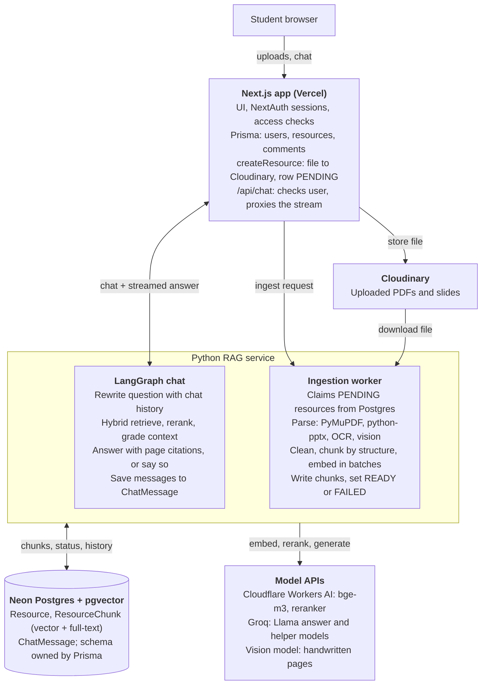
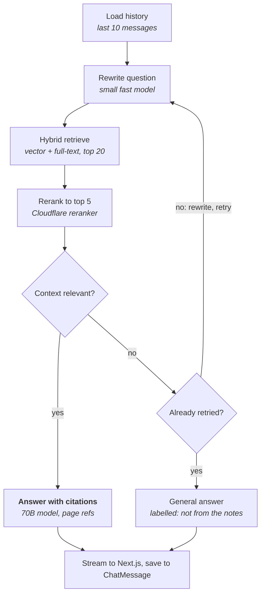
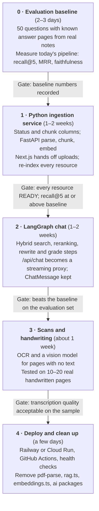

# HiveNote RAG Overhaul: Findings & Plan

As of Oct 17, 2026

## Summary

HiveNote's RAG pipeline moves to a Python service: FastAPI for document ingestion, and LangGraph for the whole chat flow. Next.js keeps the UI, auth, uploads and access checks, and becomes a thin streaming proxy for chat.

- **Already fixed:** chat retrieval had been failing on every request since 2026-03-27, so every answer came from general knowledge. It now runs, and a test against real pgvector covers it.
- **Biggest remaining defect:** PPTX extraction embeds zip/XML junk and none of the slide text. PDF extraction loses headings and column order.
- **Python's real advantage** is its document parsers. The LangGraph chat is justified by the multi-step flow it enables: rewrite the question, retrieve, grade the context, then answer.
- **Next step:** build a ~50-question evaluation set and measure the current pipeline before rebuilding it, so the improvement can be shown with numbers.

## Changes made so far

All changes are local and uncommitted. Each one was checked with a type-check, the Vitest suite (14 tests) and, for database changes, a throwaway pgvector container. Neon was never touched.

| Area | Change | Verified by |
| --- | --- | --- |
| Retrieval | `src/lib/rag.ts`: HNSW settings run as separate statements inside a transaction; chat now logs retrieval errors instead of hiding them | Unit test + integration test against pgvector |
| HNSW index | Migration history confirmed drift-free; schema comment explains why the `@@index` line must stay | `prisma migrate diff` on a fully migrated DB: empty |
| Auth security | University email check now matches the exact domain or a subdomain; previously `notadaniuni.ac.in` passed | Unit tests |
| Google sign-in | Removed from README and auth docs (code already had none); NextAuth Prisma adapter removed | Type-check |
| OAuth tables | Migration `20261017000000_remove_oauth_tables` drops `Account` and `Session` | Fresh DB: all migrations apply, no drift, HNSW index intact |
| Packages | Removed unused `@ai-sdk/google`, `@ai-sdk/react`, `framer-motion`, `@auth/prisma-adapter` | Type-check |
| Env | `.env.example` gains `GROQ_API_KEY`, Cloudflare notes, optional `DIRECT_URL` | — |
| Tests | Vitest added (`pnpm test`): chunking, university domains, retrieval SQL, plus a pgvector integration test that runs when `TEST_DATABASE_URL` is set | 14 passing |
| Docs | `CLAUDE.md` created and no longer git-ignored | — |
| Tooling | `node_modules` was broken (empty package folders) and was reinstalled from the lockfile | — |

**Before deploying:** apply the new migration to Neon with `pnpm exec prisma migrate deploy`. It deletes any rows left in `Account` and `Session`.

## Problems in the current RAG pipeline

Each problem below was either reproduced on test files (a 2-slide PPTX and a 2-page, two-column PDF) or read directly from the code.

| Stage | Problem | Evidence | Impact |
| --- | --- | --- | --- |
| Retrieval | Multi-statement SQL (`SET LOCAL …; SELECT …`) in one prepared statement; error swallowed by `.catch(() => [])` | Postgres error 42601, reproduced locally | Every chat answer ignored the document since 2026-03-27. **Fixed.** |
| PPTX extraction | A .pptx file is a zip archive, but the code reads it as raw text | 12,458 chars of zip/XML extracted, zero slide words | Slides are effectively not searchable |
| Legacy .ppt | Upload form accepts `.ppt` but nothing parses it | Code read | Same as above |
| PDF extraction | Text items joined with spaces, so line breaks and headings are lost | Test PDF output | Can't chunk by section |
| PDF extraction | Two-column pages interleave line by line | "LEFT COLUMN: searching… RIGHT COLUMN: deletion may merge costs O(log n)…" | Garbled sentences in chunks |
| PDF extraction | Hyphenation not repaired; page header/footer kept on every page | "clus- tering", "CS201 … Page 1" | Noise in every chunk |
| PDF extraction | Scanned or handwritten pages produce no text, silently | Code read | Chat falls back to general knowledge with no warning |
| Chunking | Fixed 400-word windows, 40-word overlap, ignores sections and slides | Code read | Chunks cut across topics |
| Indexing | Runs inside the upload request; one embedding HTTP call per chunk, sequentially; not transactional; no status or retry | Code read | Long PDFs can time out on Vercel; partial indexes stay behind silently |
| Query | Searches with only the latest user message | Code read | Follow-ups like "explain the second one" retrieve poorly |
| Retrieval | Vector-only; always 5 chunks with no relevance threshold; no reranker | Code read | Exact terms ("Banker's algorithm") missed; irrelevant context injected |
| Chat | Whole history sent every turn, no truncation | Code read | Token cost and Groq rate limits grow with chat length |
| Quality | No evaluation set | — | No way to prove a change helps |

## Will Python fix extraction? Can it read handwriting?

The language doesn't fix extraction; Python's libraries do. PPTX and typed PDFs get much better. Scanned pages need OCR. Handwriting needs a vision model or a cloud handwriting OCR, not Tesseract.

| Input | Python approach | Expected result |
| --- | --- | --- |
| PPTX | python-pptx: titles, text boxes, tables, speaker notes, per slide | Fully solved. (A JS zip parser could also do this; Python just makes it easier.) |
| Legacy .ppt | Convert to .pptx with LibreOffice headless in the container, or stop accepting .ppt | Solved if converted |
| Typed PDF | PyMuPDF / pymupdf4llm → Markdown with headings and reading order; Docling for heavy tables | Much better: headings, columns and tables preserved |
| Scanned typed PDF | Detect pages with almost no text → OCR (Tesseract via PyMuPDF, or RapidOCR) | Good for clean scans |
| Equations | Docling's formula model or a vision model → LaTeX | Partial; check on real notes |
| Diagrams and figures | Vision model writes a short description per image | Searchable by description only |
| Slides exported as images | Treat as scanned pages (OCR or vision model) | Good if text is large |
| Handwritten notes | Vision LLM or cloud handwriting OCR (below) | Usable for neat handwriting; weak on messy writing, dense math and diagrams |

**Handwriting options:**

- **Vision LLMs** (Gemini, Claude or GPT-class models, or open models such as Qwen2.5-VL): send each page image, get Markdown back with headings, lists and LaTeX for formulas. Best quality on mixed notes; billed per page.
- **Cloud OCR with handwriting support:** Google Cloud Vision (document text detection), Azure AI Document Intelligence (Read model), AWS Textract. Gives plain text lines, cheaper per page, no structure.
- **Open source** (TrOCR, PaddleOCR): weaker on full pages of handwriting; not recommended as the main path.

**How it fits:** run handwriting/OCR only on pages where the normal parser finds almost no text. Mark those chunks as transcribed, and link citations to the page image so students can check the original. Accuracy depends on legibility, so measure it on 10–20 real handwritten pages before promising it.

## Target architecture

Next.js stays the only public entry point. The Python service does all document and chat work, and only Next.js may call it, using a shared secret.

The chat stream keeps today's protocol (a first line of source JSON, then answer text), so `ResourceChatBot.tsx` needs no change. Ingestion is triggered by Next.js and backed by a Postgres job claim, so a lost request is retried.

## LangGraph chat design

The whole chat runs as one LangGraph graph in Python. It retries retrieval once with a rewritten question, and says so when the notes don't cover the answer, instead of quietly falling back as today.

- **Models:** Groq `llama-3.3-70b-versatile` writes the answer; a small fast model (e.g. `llama-3.1-8b-instant`) rewrites and grades, so those steps add little delay.
- **Hybrid retrieve:** pgvector cosine top 20 plus Postgres full-text top 20, merged by reciprocal rank fusion, filtered to the resource (later: to a subject).
- **State:** question, last 10 messages, rewritten query, candidates, final chunks, retry count, answer, sources.
- **Memory:** `ChatMessage` stays the history the UI shows. A LangGraph Postgres checkpointer is optional; if used, it lives in a separate `langgraph` schema so Prisma never tries to drop its tables.
- **Streaming:** LangGraph `stream_mode="messages"` → FastAPI `StreamingResponse` → Next.js passes it through. The first line still carries the sources JSON.
- **Limits:** at most one retry; the 30-second budget of the Vercel proxy (`maxDuration`) applies end to end.

## Chunking strategy for study material

Split along the document's own structure first; treat semantic chunking as an experiment that must win on the evaluation set before it ships.

1. **Follow the structure.** PDFs split on headings from the Markdown output. Slides become one chunk each, with tiny slides under the same title merged and very long ones split.
2. **Split long sections at natural boundaries.** Paragraph, then sentence, to roughly 400 tokens with about 50 tokens of overlap (`RecursiveCharacterTextSplitter`, token-based).
3. **Add a context header to every chunk before embedding,** for example `CS201 Notes › Unit 3: B-Trees › p.12`. It's cheap and helps retrieval because the chunk then carries its topic.
4. **Semantic chunking as an experiment.** It splits where the meaning of consecutive sentences shifts, but needs one embedding call per sentence, and published comparisons show mixed gains over a good recursive split. Try it on long, unstructured sections only.
5. **Store structure with each chunk:** section title, page or slide number, chunk type (text, table, transcribed handwriting, figure description). This drives citations and filtering.

## What changes in the repo

Prisma stays the only owner of the database schema; Python reads and writes those tables but never migrates them.

**Database (Prisma migrations):**

- `Resource`: add `indexStatus` (PENDING, PROCESSING, READY, FAILED), `indexError`, `indexedAt`, `parserVersion`.
- `ResourceChunk`: add `sectionTitle`, `slideNumber`, `chunkType`, and a generated full-text column (`tsvector`) with a GIN index, written as hand-made SQL like the HNSW index.
- `ChatMessage`: unchanged; it stays the source of truth for chat history shown in the UI.
- LangGraph's own checkpoint tables, if used, live in a separate Postgres schema (`langgraph`) so `prisma migrate dev` never sees them and tries to drop them.

**Next.js:**

- `createResource`: drop extraction and embedding. Upload to Cloudinary, create the row as PENDING, then hand off to the Python service after responding (`after()` from `next/server`, or Upstash QStash for retries).
- `/api/chat`: keep the session, university-email and same-university checks, then proxy the request to the Python `/chat` endpoint and stream the response back unchanged.
- Resource page: show "Indexing…" / "Failed — retry"; enable chat only when READY.
- Remove `pdf-parse`, `src/lib/embeddings.ts`, `src/lib/rag.ts`, `scripts/backfill-embeddings.ts`, and the `ai` / `@ai-sdk/groq` packages once chat runs in Python.

**New folder `services/rag/`:** `pyproject.toml`, `app/` (FastAPI routes, ingestion pipeline, LangGraph graph), `tests/`, `Dockerfile`, plus a root `docker-compose.yml` that runs Postgres + pgvector, the Python service and Next.js locally.

## Python service stack

| Job | Tool | Notes |
| --- | --- | --- |
| API | FastAPI + Pydantic, uvicorn | Typed request/response models; streaming responses |
| Packaging | uv, `pyproject.toml` | Fast, lockfile-based installs |
| PDF parsing | PyMuPDF / pymupdf4llm | Headings, reading order, tables as Markdown. AGPL licence: fine for an open-source project; otherwise use Docling (MIT) |
| Heavy layout | Docling | Better tables and formulas; larger container (ML models) |
| PPTX | python-pptx | Slides, tables, speaker notes |
| .ppt conversion | LibreOffice headless | Only if .ppt uploads stay allowed |
| OCR (typed scans) | Tesseract or RapidOCR | Only for pages with almost no text |
| Handwriting | Vision LLM or cloud handwriting OCR | See the extraction section |
| Chunking | langchain-text-splitters | Markdown-header and recursive splitters |
| Embeddings | Cloudflare Workers AI `bge-m3`, batched | Same model and 1024 dimensions as today; no re-architecture of the vector column |
| Reranking | Cloudflare `bge-reranker-base` | Reorders the top ~20 candidates |
| Chat orchestration | LangGraph | Graph of rewrite → retrieve → grade → answer |
| LLMs | Groq via `langchain-groq`: `llama-3.3-70b-versatile` to answer, a small fast model (e.g. `llama-3.1-8b-instant`) to rewrite and grade | Same provider as today |
| Database | psycopg 3 + pgvector-python | Same Neon database, raw SQL |
| Background jobs | Postgres job claim (`FOR UPDATE SKIP LOCKED` on PENDING resources) | No extra queue service needed |
| Tests | pytest + a pgvector test container | Same approach as the Vitest integration test |
| Evaluation | Own script or RAGAS | recall@k, MRR, faithfulness |

## Deployment

With chat in Python, the service sits on every chat request, so it should stay warm. Use Railway (always on), or Cloud Run with one minimum instance. Next.js stays on Vercel.

| Option | Fit | Trade-off |
| --- | --- | --- |
| Railway | Recommended | Simplest setup; always on; small monthly usage bill (approximate, check current pricing) |
| Google Cloud Run, min instances = 1 | Good | Long timeouts for big PDFs; scales up for ingestion bursts; the always-on instance costs money, while scale-to-zero adds cold starts to chat |
| Render free tier | Poor | Sleeps when idle; close to a minute to wake |
| Vercel Python functions | Poor | Can't ship Tesseract or LibreOffice; bundle size and duration limits |

**What deployment needs:**

- A Dockerfile on `python:3.12-slim`, plus Tesseract (and LibreOffice only if .ppt stays).
- Env vars: `DATABASE_URL` (Neon), `CLOUDFLARE_ACCOUNT_ID`, `CLOUDFLARE_API_TOKEN`, `GROQ_API_KEY`, `RAG_SERVICE_SECRET`. On Vercel: `RAG_SERVICE_URL` and the same secret.
- Service-to-service auth: Next.js sends the shared secret (or an HMAC of the request body); the Python service accepts nothing else and never sees user sessions.
- GitHub Actions: run pytest, build the image, deploy on merge to `main`.
- Health check endpoint, request logging, and a timeout per ingestion job.

## Roadmap

About 4–6 weeks part-time in total, starting with the evaluation set so every later phase can prove it helped. Estimates are rough.

Each gate must pass before the next phase starts. Phases 1 and 2 can overlap once the schema changes from phase 1 have landed.

## Resume points

Measured before/after numbers carry more weight than framework names. Fill the X/Y values from the evaluation set; drop any line whose feature didn't ship.

- Built a RAG pipeline for a university study-material platform: a FastAPI ingestion service (PyMuPDF, python-pptx, OCR) with structure-aware chunking, pgvector HNSW and Postgres full-text hybrid search, and reranking. Retrieval recall@5 rose from X% to Y% on a 50-question evaluation set.
- Designed a LangGraph chat agent (question rewriting, relevance grading, cited answers) streaming through a Next.js proxy; answer faithfulness rose from X to Y.
- Diagnosed a production bug that silently disabled retrieval for every chat request (multi-statement SQL in a prepared statement); fixed it and added an integration test against real pgvector.
- Moved document indexing out of the upload request into a Postgres-backed job queue with status tracking and retries, cutting upload time from X s to Y s for a 100-page PDF.
- Added handwritten-note support by routing text-less pages to a vision model; transcription accuracy of X% on Y sample pages.

## Risks and open questions

- **Two languages, two deployments.** Local dev needs both running; docker-compose covers it.
- **Schema drift between Prisma and Python.** Mitigation: Python touches only `ResourceChunk`, `ChatMessage` and the index-status columns, and an integration test runs both against the same migrated database.
- **Chat latency.** One extra network hop plus a rewrite and grade step before the answer starts. Use the small model for those steps and stream the answer.
- **Groq rate limits.** Three LLM calls per question instead of one; check the plan's tokens-per-minute limit.
- **Handwriting quality and cost.** Unknown until tested on 10–20 real pages.
- **PyMuPDF AGPL licence.** Fine if the repo stays open source; otherwise use Docling.

- [ ] Which hosting: Railway or Cloud Run?
- [ ] Keep accepting legacy .ppt (needs LibreOffice) or accept .pptx only?
- [ ] Which vision model or OCR provider for handwriting, and what per-page budget?
- [ ] Production Neon DB: confirm the HNSW index exists and how many resources have zero chunks.
